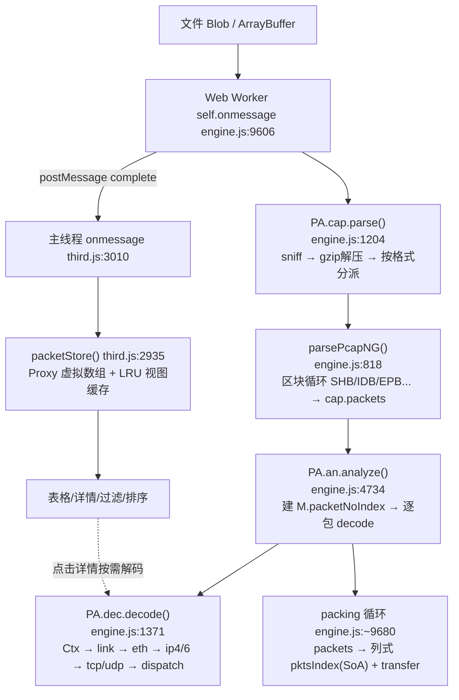

---
AIGC:
    Label: "1"
    ContentProducer: 001191440300708461136T1XGW3
    ProduceID: 91a6ec231204528cf058fec04d8653c4_be9b637cac4311f188ac525400dcc5b3
    ReservedCode1: Nq1Ez5Ucu/IteaVlETqO2y5QGPUbAK8Hy7LTXrqy0tQshFUQqDN1C8H3zjfVDHdqDkVBK1PfxLJTnj+6YjKZ0VqgnZKZe7wPDe/2k1uvzjBYYU+4VRGnmA3gg6yTQiSwd1vxi51kqvB+M95nq+ZdzC1NcC8K7MoVoQrYClrAreokSugtqLHn//LDk38=
    ContentPropagator: 001191440300708461136T1XGW3
    PropagateID: 91a6ec231204528cf058fec04d8653c4_be9b637cac4311f188ac525400dcc5b3
    ReservedCode2: Nq1Ez5Ucu/IteaVlETqO2y5QGPUbAK8Hy7LTXrqy0tQshFUQqDN1C8H3zjfVDHdqDkVBK1PfxLJTnj+6YjKZ0VqgnZKZe7wPDe/2k1uvzjBYYU+4VRGnmA3gg6yTQiSwd1vxi51kqvB+M95nq+ZdzC1NcC8K7MoVoQrYClrAreokSugtqLHn//LDk38=
---

# PacketLens pcapng 解包逻辑拆解 —— 面向 Go 重构的分析文档

> 分析对象：`C:\Users\Elysia\Desktop\PacketLens`（核心文件 `index.html`，17903 行）
> 分析方法：将 `index.html` 内三段 `<script>` 块分别提取为 `engine.js`（第二段，9861 行）、`third.js`（第三段，8015 行）、`first.js`（首段，146 行）进行逐段精读，所有行号均基于提取后的文本文件可复核。
> 行号约定：本文所有 `engine.js:NNN` 表示 **index.html 第 2 个 script 块（engine-src）内部的行号**，对应 index.html 约第 271+NNN-1 行；`third.js:NNN` 对应 index.html 约第 10133+NNN-1 行（第三段 script 起始附近）。
> 结论：**PacketLens 没有任何独立命名的 "index.js / index-xxx.js" 文件，所谓 "index 相关逻辑" 全部内嵌在单文件 `index.html` 中**，包括：包序号索引 `packetNoIndex`、Worker 侧列式包索引 `pktsIndex`、主线程虚拟包存储 `packetStore`（third.js）与流会话索引（`sid/sdir`）等。本文按"解析器 + 索引构建/消费"两条主线拆解。

---

## 目录

1. [总体架构与模块划分](#1-总体架构与模块划分)
2. [入口链路与调用链总览](#2-入口链路与调用链总览)
3. [pcapng 文件格式解析细节（parsePcapNG 逐步拆解）](#3-pcapng-文件格式解析细节parsepcapng-逐步拆解)
4. [数据包解码流程（L2/L3/L4/L7 层层解析）](#4-数据包解码流程l2l3l4l7-层层解析)
5. [核心数据结构定义与流转](#5-核心数据结构定义与流转)
6. ["index" 相关逻辑：索引构建、打包与主线程消费](#6-index-相关逻辑索引构建打包与主线程消费)
7. [现有实现特点与可复用点](#7-现有实现特点与可复用点)
8. [Go 语言重构迁移对照与坑点清单](#8-go-语言重构迁移对照与坑点清单)
9. [附录：核心符号行号索引](#9-附录核心符号行号索引)

---

## 1. 总体架构与模块划分

### 1.1 工程形态

项目为**纯前端单文件应用**：全部逻辑在 `PacketLens\index.html`（17903 行）内，README 自述为 pcap/pcapng 抓包分析工具（类 Wireshark 的浏览器实现），采用 **Web Worker 多线程**：解析/解码/分析全部在 Worker 内完成，主线程只接收"压缩后的列式索引 + 分析模型"并做虚拟化渲染。

| 段落 | index.html 范围（约） | 提取文件 | 职责 |
|---|---|---|---|
| script #1 | 1–270 | first.js（146 行） | 浏览器 DOM 工具：toast/复制剪贴板/往外部页面注入"复制 SNI"按钮（MutationObserver），与解析无关 |
| script #2（engine-src） | 271–10131 | engine.js（9861 行） | **核心引擎（Worker 端 + 部分主线程工具）**：格式嗅探、pcap/pcapng 解析、L2-L7 协议解码、流重组、分析聚合、TLS 解密、MMDB IP 归属、Worker onmessage 主入口 |
| script #3 | 10133–17903+ | third.js（8015 行） | 主线程 UI：文件载入、Worker 调度、列式索引消费（packetStore）、虚拟滚动表格、过滤/排序、详情树、图表、导出等 |

### 1.2 引擎内部模块（engine.js 各 IIFE 划分）

engine.js 由多个 IIFE 组成，通过挂载到全局命名空间 `PA` 上通信：

| 命名空间/子块 | 位置 | 职责 |
|---|---|---|
| `PA.util`（U 工具） | engine.js 前段 | 字节序读写（`u16/u32/u32le/u64/ip4/ip6/mac`）、文本、hex、格式化 |
| `PA.cap` | L1255 导出（sniff L670 / parse L1204 / parsePcap L734 / **parsePcapNG L818** / writePcap L1234） | **抓包文件容器层**：格式识别、区块级解析、写出经典 pcap |
| `PA.dec` | L2440 导出（decode L1371 起整段 IIFE） | **协议解码层（L2-L4 + 大量 L7）**：树/统计双模式，解码结果写回 packet 对象 |
| `PA.app` | L3848 导出 | 应用层语义常量/解析器集合（DNS/TLS/HTTP/QUIC/SMB 等细节解析器，被 dispatch 调用） |
| `PA.an` | L7606 导出（analyze L4734 起整段 IIFE） | **分析聚合层**：逐包统计、端点/会话、TCP 流重组、应用层分析、威胁发现、生成模型 M |
| `PA.tlsdec` / `PA.gen` / `PA.MMDBReader` | 中后段 | TLS 会话密钥解密、演示数据生成、MaxMind MMDB 读取 |
| Worker 入口 | L9606 `self.onmessage` | 文件读取 → parse → analyze → **packets 拆列打包 pktsIndex** → transfer 回主线程 |

主线程（third.js）不重新解析文件，只消费 Worker 结果（详见 §6）。

### 1.3 解析/解码/分析分层关系



---

## 2. 入口链路与调用链总览

### 2.1 文件载入 → Worker 调度（主线程 third.js）

- `run(name, source, again)`（third.js:3009 附近起，含 L3010 大函数）是主线程唯一加载入口：接收 `Blob/File` 或 `Uint8Array`，检查 >64MB 时可选 `largeNoDetail` 关闭逐包详情，然后 `getWorker()` 取复用 Worker，把 **File 对象本身**（而非拷贝）post 给 Worker（`worker.postMessage({file, opt, mmdbUrls, keys})`）。
- 主线程 `worker.onmessage`（third.js:3010 起）处理五类消息：`progress`（read/parse/analyze/index 分阶段推进度）、`delta`（分析子阶段）、`complete`（收到 `d.M + d.cap + d.pktsIndex + d.buf`）、`error`、Worker crash（`worker.onerror` 提示重新载入）。
- **complete 到达后主线程立刻做的事**：`S.raw = new Uint8Array(d.buf)` 拿回"原始抓包字节"；`M.pktsIndex = d.pktsIndex; M._raw = S.raw; M.packets = packetStore(d.pktsIndex, M)`（third.js:3010）—— 主线程包列表是**基于索引虚拟化**的，不持有数万 packet JS 对象。

### 2.2 Worker 端解析入口（engine.js:9606 `self.onmessage`）

Worker 内处理顺序（try/catch 包裹，任一失败回传 `{type:'error'}` 并 `self.close()`）：

1. 读文件：`new Uint8Array(await e.data.file.arrayBuffer())`（File 直接在 Worker 读，主线程不持第二份拷贝）。
2. 可选加载 MMDB（`fetch` 主线程 URL）、TLS 解密密钥 `PA.tlsdec.importKeys(e.data.keys)`。
3. `PA.cap.parse(u8, opt, yieldFn)` → `cap`。
4. `PA.an.analyze(cap, {}, yieldFn)` → 分析模型 `M`，进度回调把 0-1 映射为 decode/base-aggregate/flow-reassembly/application/security 五阶段。
5. **索引打包（关键）**：断开 `M.packetNoIndex / M.packetIndexByNo / M._certBySha` 的强引用；将 `M.packets` 逐字段拷入 TypedArray 列（`pktsOff/pktsCap/pktsLt/pktsT/pktsLen/pktsUsec/pktsSid/pktsSdir/...` + 字符串列字典化），每写完一行 `pkts[i] = null` 释放对象；`cap.packets=null; cap.raw=null` 后再 `postMessage` —— 避免结构化克隆几十万对象。
6. 流元数据瘦身：`streams[].pkts` 打包为 Uint32Array、`segs` 打包为 `{abs,off,len,idx,time}` SoA（engine.js:9758 附近 `packSegments`），清空大重组缓冲 `s.buf/s.plain/s.map`；对 http/dns/findings/conversations 等列表做上限裁剪并记录到 `M.limits.transfer`。
7. `postMessage({type:'complete', M, cap, pktsIndex, buf:rawU8.buffer}, tx)` —— **索引、分析模型、原始字节同一消息原子转移**（历史 Bug：分两阶段会把已 detached 的 ArrayBuffer 再次克隆）。

### 2.3 格式识别 parse()（engine.js:1204）

```
parse(u8, opt, yieldFn)
 ├─ sniff(u8) engine.js:670
 │    magic 0x0a0d0d0a → 'pcapng'
 │    0xa1b2c3d4/0xd4c3b2a1/0xa1b23c4d/0x4d3cb2a1 → 'pcap'
 │    0xa1b2cd34/0x34cdb2a1 → 'pcap-mod'
 │    gzip(1f 8b) / snoop / mitm / netmon / sniffer / zip ...
 ├─ kind==='gzip' → gunzip()（engine.js:687，DecompressionStream，512MiB 上限 + 256x 膨胀上限）后再次 sniff
 ├─ pcapng → parsePcapNG()
 ├─ pcap/pcap-mod → parsePcap()  （经典 pcap，含损坏帧 resync 重对齐，engine.js:734-816）
 ├─ snoop/mitm → 各自解析器
 └─ 其余 → 抛"不支持的抓包格式"
```
成功后统一 `r.gz=gz; r.raw=u8; r.kind=kind` 挂回；`cap.raw` 供下游按 `_off` 零拷贝取原始字节。

---

## 3. pcapng 文件格式解析细节（parsePcapNG 逐步拆解）

`parsePcapNG(u8, opt, yieldFn)`（engine.js:818-1013）是核心，纯顺序扫描、无 seek、无重对齐（与 pcap 的 resync 策略不同，见 §7）。

### 3.1 顶层状态与字节序切换（关键设计）

```js
var off = 0, no = 0, le = true, limit = opt.limit || 1e9;   // engine.js:822
function g32(b,o){ return le ? U.u32le(b,o) : U.u32(b,o); } // 块内字段按本节字节序
function g16(b,o){ return le ? U.u16le(b,o) : U.u16(b,o); }
function opts(b,s,e){ ... }                                 // engine.js:826 通用选项迭代器
```

- **第一眼魔数用 LE 试读**：`type = U.u32le(u8, off)`，若等于 `0x0a0d0d0a` 判定为 SHB（该值字节序无关，两端都是 0a0d0d0a 的翻转，先按 LE 读即可命中）。
- **字节序锚点**：遇到 SHB 读 `off+8` 的 BOM：`U.u32(...)=0x4d3c2b1a` 说明存储为 LE；`0x1a2b3c4d` 为 BE。随后**整节的 le 标志切换**，后续块（IDB/EPB...）按新字节序读取（大端文件里 IDB 的类型字面是 `00 00 00 01`，所以非 SHB 块用 `g32` 而不是固定 `u32le`）。**一个 pcapng 可以含多个 section，字节序可中途改变**，此处能正确处理。
- 每轮循环先校验：
  - `tlen < 12` / `tlen & 3 != 0`（四字节对齐）/ `tlen > u8.length - off`（越界/截断）→ 记 warns 并 `break`（**坏块直接终止**，不尝试滑动恢复）；
  - `tail !== tlen`（块首尾长度字段不一致）→ warns 并 break；
  - `minBlock` 表（engine.js:856）：`SHB:28, IDB:20, EPB:32, SPB:16, PB:32, NRB:16, ISB:24, DSB:20, 默认 12`，块长小于该类型最小长度 → warns 并 `off += tlen; continue`（跳过该块继续，防止 OOB 读）。
- `bs = off+8`（body 起点），`be = off+tlen-4`（body 终点，不含 trailer）。

### 3.2 各区块处理对照表

| 区块类型 | 分支 | 关键处理 | engine.js 行 |
|---|---|---|---|
| **SHB** `0x0a0d0d0a` | case | 版本 `major.minor`（off+12/14）；选项区 `opts(u8, off+24, be)`：code 1→comments、2→hardware、3→os、4→app（写 `res.meta`）；`res.sections++` | 872-889 |
| **IDB** `1` | case | 链路类型 `lt=g16`、snaplen `sn=g32`；构造 `ifc` 对象（默认 `tsscale:1e6, tsoff:0`）；选项：2 name、3 desc、4 IPv4 地址+掩码（8B）、6 MAC、8 if_speed（u64）、**9 if_tsresol→tsScale()**、11 filter、12 os、15 hardware、**14 if_tsoffset（u64）**；首个接口写入 `res.linktype/res.snaplen` | 890-914 |
| **EPB** `6` | case | 读 `iid/th/tl/caplen/origlen`（bs+0..16）；**64 位时间戳** `raw = th*4294967296 + tl`（高 32 位溢出即 >2^53，**未用 BigInt**，理论限制 1970-2255 年安全、更远会丢精度，正常抓包无影响）；`secs=floor(raw/sc)+ifc.tsoff; frac=(raw-floor*sc)/sc`；数据区 `bs+20 → min(bs+20+cl, be)`，抓包长度超界则截断记 warns；`makePacket({...})`；尾部选项区：EPB 无 padding 时从 `bs+20+cl+((4-(cl%4))%4)` 开始（**正确处理 4 字节对齐 padding**）：code 1→pk.comment、2→pk.dir(低2位 1=入/2=出)、5→pk.pid | 915-952 |
| **SPB** `3` | case | 只有 origlen，无时间/接口；按 ifaces[0].snaplen 裁剪 caplen；`noTime:true` 包 | 953-962 |
| **旧 Packet Block** `2`（obsolete） | case | 字段布局同 EPB 但接口 16 位、cap 后跟 padding；同款时间戳换算；`res.warns` 截断提示 | 963-975 |
| **NRB** `4` | case | 名称解析记录：内层子选项循环 rt==1 IPv4(5B+名)、rt==2 IPv6(17B+名)；以 `\u0000` 切分多名字，取第一个写 `res.nrb[addr]` | 976-992 |
| **ISB** `5` | case | 接口统计：ts 选项 2/3（start/end）、4/5/6/7/8（recv/drop/filtacc/osdrop/deliv）；64 位按 `u32le(4)*2^32+u32le(0)` | 993-1000 |
| **DSB** `10` | case | 解密密钥块：`secrets=type(4B)+len(4B)+data`；类型字节序兼容判断（`0x544c534b`/"TLSK"/"KSLT" → TLS keylog）写入 `res.secrets` | 1001-1009 |
| custom `9` 等 | case | 显式空分支跳过（解析器不读未来自定义块内容，仅跳过） | 1010-1011 |

循环结束兜底（engine.js:1012-1015）：`if (!res.ifaces.length)` 补默认 `{linktype:1, snaplen:0, tsscale:1e6}`（伪装成 Ethernet，保证后续解码不崩）；`res.linktype==null` 用 ifaces[0]。

### 3.3 选项迭代器 opts()（engine.js:826-836）

```js
while (s+4 <= e) {
  code=g16; ln=g16; s+=4;
  if (code===0) break;            // opt_endofopt
  if (s+ln > e) break;            // 越界保护
  out.push({code, val: subarray(s, s+ln)});
  s += ln + ((4-(ln%4))%4);       // 选项体也按 4 字节对齐
}
```
不拷贝值（`subarray` 零拷贝视图），由调用方用 `U.txt/U.ip4/U.u64` 等按需解释。

### 3.4 时间精度换算 tsScale（engine.js:715-718）

```js
function tsScale(tsresol){
  if (tsresol == null) return 1e6;
  if (tsresol & 0x80) return Math.pow(2, tsresol & 0x7f);  // 二进制分辨率
  return Math.pow(10, tsresol);                            // 十进制：0=秒,3=毫秒,6=微秒,9=纳秒
}
```
每个 EPB 都做 `raw/sc → secs+frac`，包级统一存储 `t`（秒，浮点，**全局相对时间轴**）与 `usec`。

---

## 4. 数据包解码流程（L2/L3/L4/L7 层层解析）

### 4.1 解码入口 decode()（engine.js:1371-1449）

```js
function decode(p, linktype, tree) {
  p.lt = linktype;                 // 记录实际链路类型（回退/详情提示用）
  var ctx = new Ctx(p, tree);      // 树模式构建 layers；统计模式只拼 pathStr
  p.proto=''; p.info=''; p.src=''; p.dst=''; ...  // 重置解码字段
  try { link(ctx, 0, p.b.length, linktype); }
  catch(e){ p.mal=true; p.info='[解码异常: ...]'; if(tree) 详情树追加'解码异常'节点; }
  // 兜底：无 src → esrc/edst；无 proto → 按 ist/IPPROTO/ipv/etype 推断，最终 LINK<linktype>
  if (p.cap < p.len) p.snapped = true;      // snaplen 截断标记
  if (!tree) p.pathStr = ',' + ctx.pathStr + ',';   // 逗号包裹便于子串匹配
  return ctx.layers;
}
```

### 4.2 Ctx 双模式（engine.js:1266）

- 构造时按 `tree` 参数选择模式：
  - **tree=true（详情视图）**：维护 `this.layers` 数组与 `cur` 当前层，`L(id,label,off,len)` 建层、`F(label,v,off,len,cls)` 加字段 —— 主线程点开包详情时才走，构建完整协议树。
  - **tree=false（批量统计）**：`L/F` 退化为把层名 `pathStr += ','+name` 拼接成字符串（并累加 `poff/plen`），**不分配对象** —— analyze() 全量解码走此模式，极致压 GC。
- 设计亮点：`_layers/_isTreeMode` 曾用全局复用；现改为实例私有数组，但保留"统计模式零分配"理念。每次 `decode()` 前重置 `p.proto/info/src/dst/w/poff/plen/ckbad`，支持**同一包重复解码**（Worker 内统计模式、主线程详情模式互不污染）。

### 4.3 链路层分发 link()（engine.js:1558）

按 `linktype`（来自该包所属 IDB）分发，典型映射：

| LINKTYPE | 处理函数 | 说明 |
|---|---|---|
| 1 (Ethernet) / 279 | `eth()` engine.js:1796 | Ethernet II，主流路径 |
| 0/108 (loopback/raw) | `rawIp()` engine.js:1523 | 4/6 版本自适应 |
| 12/14/101/228/229 | `rawIp` | raw IP（按首字节版本） |
| 113/276 | SLL/SLL2 | Linux cooked：解析协议/地址后进 etherPayload |
| 9/50/204 | PPP/PPP-over-xxx | 握手/协议字段 |
| 105/119/127/163 等 | 802.11/radiotap/PPI | 无线：含 SA/DA/BSSID、SSID 解析（engine.js:1731 附近 802.11 层） |
| 其他 | `rawIp`/默认 raw | 无法识别也尝试 IP 结构回退 |

`link()` 在真正进 L2 前若发现数据不足（如 `<14` 字节）会回退 `rawIp`；解码异常统一抛给 decode() 的 try/catch 标记 `mal`。

### 4.4 Ethernet 与链路层隧道展开

- `eth()`（engine.js:1796）：解析 6B dst MAC + 6B src MAC + EtherType；写 `p.esrc/p.edst/p.etype`；封装 `p.ckbad` 校验错误、`p.mal` 解析错误；随后交 `etherPayload()`。
- `etherPayload()`（engine.js:1938）**递归/循环展开** EtherType 分派，含关键隧道与封装：
  - `0x0800 IPv4`→ip4()；`0x86dd IPv6`→ip6()；`0x0806 ARP`→arp()（engine.js:2015）；
  - `0x8100/0x88a8/0x9100` VLAN → 剥 4B 后递归 etherPayload（802.1Q）；
  - `0x8847/0x8848` MPLS → 标签栈展开后按内层判定；
  - `0x8863/0x8864` PPPoE（engine.js:1968 附近：含 PPPoE Active Discovery / PPP Session）→ 剥离后进 PPP → 再 IP；
  - `0x88cc LLDP`、`0x888e EAPOL` 等直接标注层；
  - 未知 EtherType → 记 `EtherType-0x...` raw。
- `llc()`（engine.js:1767）处理 802.2 LLC/SNAP。
- 链路层也支持 `radiotap→802.11`、`802.11` 数据帧 QoS/LTC 等（无线解析在 engine.js:1680-1795 区间，含 beacon 管理帧 SSID/BSSID/RSN/WPA 提取、`p.ssid/p.bssid/p.wlanDeauth` 等供上层聚合）。

### 4.5 网络层

- `ip4()`（engine.js:2039）：
  - IHL 检查（<20 或 >60 均拒绝）、Total Length、TTL、协议号、校验和；
  - 源/目的 IP 以字符串与**整数双写**：`p.isrc/p.idst`（展示）与 `p.isrcN/p.idstN`（u32 用于 O(1) 过滤/会话 key，engine.js 压缩轨迹中的加速字段）；
  - **分片**：解析 `fo/mf/df`，设 `p.fragmented=true`；**非首片（fo>0）直接 raw 结束，不重组**；首片继续向上；分片端口信息由上层 `fragPorts`（analyze 阶段回填：若后续分片无端口则用首片端口补齐，engine.js:2087/2138 标记处与 analyze 中 fragPorts 逻辑配套）；
  - IP 选项：仅遍历偏移并回退 raw，不逐项语义化（有长度守卫 `end`）。
- `ip6()`（engine.js:2104）：固定 40B 头 + **扩展头循环**（hop-by-hop/routing/fragment/destination/ah 等，最多 8 层深度保护），下一头为 L4 时调 `ipProto()`。
- `ipProto()`（engine.js:2147）：按协议号分发：6→tcp()、17→udp()、1→icmp()（engine.js:2344）、2→igmp、47→gre()（engine.js:2219，GRE 内可再进隧道）、132→sctp()（engine.js:2235）、50/51→ESP/AH（标注加密载荷）、4/41/97→IPIP/6in4/etherip 隧道递归等。

### 4.6 传输层与应用层

- `tcp()`（engine.js:2255）：端口/seq/ack/标志位/窗口/选项（MSS、WS、SACK、TS 等）；**伪头校验和验证**（错误写 `p.ckbad`）；设置 `p.sp/p.dp/p.tf`（标志位压缩）、`p.ist=6`；有载荷时调 `PA.app.dispatch(ctx,...)`。
- `udp()`（engine.js:2321）：端口/长度/校验和（同样验证，不通过仅标记不丢包）；`p.ist=17`；载荷进 dispatch。
- `dispatch(ctx, off, end, l4)`（engine.js:3619）—— **L7 识别策略：UDP 端口优先，TCP 内容嗅探优先**：
  - UDP：一串端口表（53 DNS / 5353 MDNS / 5355 LLMNR / 137-138 NetBIOS / 67-68 DHCP / 546-547 DHCPv6 / 123 NTP / 161 SNMP / 1900 SSDP / 5060-5061 SIP / 69 TFTP / 514 syslog / 1812 RADIUS / 4789 VXLAN / 6081 Geneve / 3478 STUN / 51820 WireGuard / 1194 OpenVPN / 500/4500 ISAKMP / 520 RIP / 2152 GTP / 6343 sFlow / 11211 Memcached / 5683-5684 CoAP/DTLS / RTP 启发式（首字节 10xxxxxx + 偶端口）等）；
  - UDP/443 特判：先做 **DNSCrypt 引导 DNS-over-443 结构校验**（防误判），再检查 QUIC Fixed Bit `(b[off]&0x40)` 走 `quic()`（engine.js:3330）；
  - TCP：`httpLike()`（engine.js:3084 特征嗅探）→ http()（3096）；TLS 记录头 `0x16 03 xx`/握手 `0x16 01 01`（tls() engine.js:2984）；SSH banner、SMB（`\xfeSMB`/`\xffSMB` 及 NetBIOS 会话层 4B 头剥离）、以及各端口对应协议（139/445 SMB、22 SSH 等）。
  - dispatch 内部还有大量内容级启发（DHCP 消息类型、STUN magic 0x2112a442、RTCP/RTP、BitTorrent DHT `d1:` 等），L7 解析结果通过 `ctx.p.dns/http/tls/dhcp/...` 挂到包上，供 analyze 阶段聚合。
- 各 L7 细解析器均为"边界检查 + 容错 return"风格，失败返回不抛异常（保证单个畸形包不拖垮全量分析）。

### 4.7 解码链路与上层字段汇总（包对象上可见的解码产物）

| 层 | 典型字段 |
|---|---|
| frame | `no/sec/usec/t/rel/cap/len/iface/comment/dir/noTime/snapped` |
| L2 | `esrc/edst/etype/lt/ssid/bssid/wlan.*` |
| L3 | `ipv/isrc/idst/isrcN/idstN/ttl/ipid/iplen/df/mf/fo/fragmented/ipp` |
| L4 | `ist/sp/dp/tf/sid/sdir/plen/poff/ckbad/reTx/tcpEv` |
| L7 | `proto/info/pathStr + 对象引用 dns/http/tls/dhcp/dhcp6/arp/ic/sip/smb/mqtt/sql/syslog/nbns/tftp/radius/telnet/quic/topt/stun/...` |
| 异常 | `mal/ckbad/snapped` |

---

## 5. 核心数据结构定义与流转

### 5.1 makePacket 初始字段模板（engine.js:720-733）

```js
function makePacket(meta){
  var p = {
    no:0, sec:0, usec:0, t:0, cap:0, len:0, iface:0, b:null, _off:0, noTime:false,
    proto:'?', info:'', src:'', dst:'', sp:0, dp:0, ist:0, tf:0, plen:0, poff:0,
    sid:-1, sdir:0, reTx:false, tcpEv:null, path:null, w:null, ipv:0, isrc:'', idst:'',
    ttl:0, esrc:'', edst:'', etype:0, ipid:0, iplen:0, df:false, mf:false, fo:0,
    mal:false, ckbad:null, ic:null, dhcp:null, dns:null, tls:null, http:null, snmp:null,
    radius:null, sip:null, smb:null, mqtt:null, sql:null, syslog:null, nbns:null,
    tftp:null, telnet:null, quic:null, topt:null, arp:null, fragmented:false
  };
  if (meta) for (var k in meta) p[k]=meta[k];   // parse 阶段注入 no/cap/t/b/_off 等
  return p;
}
```
意图：**一次性固化 V8 hidden class**（注释明言"内存直降 30%"），后续解码/分析阶段只赋值不新增属性，避免对象形状漂移。pcap 解析路径在 parsePcap L789 也手写同结构 `_pk`。

### 5.2 文件容器 cap（parsePcapNG 返回值）

```js
{ format:'pcapng', endian:'little'|'big', version:'1.0', snaplen, linktype,
  ifaces:[{id, linktype, snaplen, name, desc, ip, mac, speed, tsscale, tsoff, filter, os, hw}],
  packets:[makePacket...], meta:{hardware,os,app}, warns:[], nrb:{}, dsb:0,
  secrets:[], comments:[], stats:[], sections }
```
parse() 额外挂 `gz/raw/kind`。

### 5.3 流对象（analyze 阶段，engine.js:5193-5203 创建）

```js
S = { id:sid++, kind:'tcp'|'udp', a,ap, b,bp,           // 规范化五元组（a=低地址方向）
      pkts:[], d:[newDir(),newDir()], t0,t1, bytes,npk,
      rstNo, swap, synNo, saNo, hsRtt, state, srvPort }
// d[0]/d[1] = 双向方向统计与分段描述符 {pkts,bytes,dbytes,segs,...}
```
- key 生成：`skey()`（engine.js:4627）对五元组排序规范化，`'T'+key`（TCP）或 `'U'+key`（UDP）；
- 命中流时写回包：`p.sid = S.id; p.sdir = dir`（engine.js:5203）—— **sid/sdir 是"包→流"的 O(1) 索引**，主线程"按 F 跟踪任意包"靠它；
- 非 SYN 的 UDP 包不建 d 分段（`D.dbytes` 累加即 continue）；
- 每流 `pkts` 引用上限受 `M.limits.streamPacketRefs.capPerStream` 约束，超出置 `S.packetRefsTruncated` 并标记 `analysisComplete=false`（说明分析不完整，UI 会提示）。

### 5.4 模型 M（analyze 返回，engine.js:4734-7606）

主要成员：`packets`（包对象数组，Worker 内全量）、**`packetNoIndex`（engine.js:4807-4811，按 no→packet 的数组索引）**、`streams/conv/endpoints/hosts/ports`、`dns/http/tls/certs/files/creds/tokens/dhcp/sip/syslog/sql/...`、`wifi`、`findings/indicators`、`proto/protoBytes/protoPkts`、`limits`、`completeness`（`indexComplete/analysisComplete` 双标记）、`_timing`。

### 5.5 分析主流程 analyze()（engine.js:4734）

1. 首轮：`decodeSafe` 式 try 逐包 `decode(p, ifaces[p.iface].linktype, false)`，计算 `rel` 相对时间、`tf/plen/poff`；
2. 并行聚合（TypedArray 统计：`protoBytesArr/protoPktsArr` engine.js:4891-4894、长度直方图、MAC/端口对、SYN 指纹）；
3. **第二遍（依赖 packetNoIndex 的后处理）**：端点/会话、DHCP/DNS/NBNS/SIP/SQL/SNMP/MQTT/LDAP/RADIUS 凭据提取、ICMP echo 配对、Wi-Fi 聚合；
4. TCP/UDP 流构建（sm/sid 循环，engine.js:5186-5215+）→ buildStream（engine.js:5521 顺序重组）→ appAnalyze（engine.js:5741 每个流做应用层语义分析，需 `S.buf`）→ 流截断清理；
5. `M.packetNoIndex` 在 4807 被创建并被第 2 遍后处理/取证模块使用；Worker 打包前显式置 null（L9654 附近）。

---

## 6. "index" 相关逻辑：索引构建、打包与主线程消费

### 6.1 分析期索引：M.packetNoIndex（engine.js:4807-4811）

analyze 第一遍解码循环结束、进入聚合前创建：

```js
M.packetNoIndex = new Array(N+1);   // 按包号(no)的下标数组
for (i=0;i<N;i++) { var pp=P[i]; if(pp) M.packetNoIndex[pp.no]=pp; }
```
用途：后续第二遍遍历（威胁检测、端点/会话、DNS 查询-响应配对、流重组按包号取原始包 `P[seg.i]`）以 O(1) 访问具体包号，避免线性查找。Worker 打包阶段（engine.js:9654 起）`M.packetNoIndex=null; M.packetIndexByNo=null; M._certBySha=null` 释放强引用，避免结构化克隆整张对象表。

### 6.2 Worker 打包：packets → 列式 SoA（engine.js:9680-9762 区间）

目标：**消灭对象图克隆**。核心步骤：

1. 字符串字典化：`strColumn()` 建 `{dict:[...], codes:Uint32Array}`，`strPut()` 把 `proto/info/src/dst/pathStr` 等重复字符串映射为小整数 code（engine.js:9686-9688）；
2. 数值列 TypedArray：`off(Uint32, 0xffffffff=无偏移)/cap(Uint32)/lt(Uint16)/t(Float64)/len(Uint32)/usec(Uint32)/sid(Int32)/sdir(Uint8)/sp(Uint16)/dp(Uint16)/isrcN/idstN(Uint32)/ipv/ist(Uint8)/tf(Uint16)/reTx/ckbad/mal(Uint8)/plen(Uint32)`；
3. 原始字节：有 `_off` 且在 `rawU8` 范围内 → 记偏移列；否则（gzip 解压前文件、无 raw 引用）拷贝进 `pktsInline`（engine.js:9696-9701）；
4. 边打包边 `pkts[i]=null` 逐槽释放；
5. 组装 `pktsIndex = { off,cap,lt,t,len,usec,sid,sdir, proto:{dict,codes}, info:{...}, src:{...}, dst:{...}, sp,dp,isrcN,idstN, ipv,ist,tf, pathStr:{dict,codes}, reTx,ckbad,mal,plen, inline, n }`（engine.js:9739-9744）；
6. `cap.packets=null; cap.raw=null` 后随 transfer 列表一起 `postMessage`（engine.js:9760-9767）。

### 6.3 主线程虚拟包存储 packetStore()（third.js:2935-3007）

Worker 回传后主线程用 Proxy 构造"虚拟包数组"：

- `packetStore(idx, M)` 内建 `C = {off,cap,lt,t,len,usec,sid,sdir,sp,dp,isrcN,idstN,ipv,ist,tf,reTx,ckbad,mal,plen}` 列视图 + 4 组字符串列 `{dict,codes}`；
- `raw(i)` 按需物化包对象：`o = {no:i+1, _storeIndex:i, _off, cap, lt, t, len, usec, sec, rel:t-t0, sid, sdir, sp, dp, isrcN, idstN, proto, info, src, dst, ipv, ist, tf, pathStr, reTx, ckbad, mal, plen, _decoded:false}`；
- **字节懒加载**：`b` 定义为 getter——首次访问时 `M._raw.subarray(_off, _off+cap)`（或取 inline），随后 `defineProperty` 固化为 value（只取一次，缓存）；
- LRU 视图缓存：`viewCache`（Map，容量 256）按访问刷新，防滚动大列表时重复物化；
- Proxy 拦截：`packets.length`、`packets[i]`、`at(i)`（支持排序序）、`_rawAt(i)`、`_sortBy(key,desc)`（TypedArray 稳定排序 third.js:2978-2984 附近 `sortBy`）、`_columns`、迭代器/forEach/map/filter/findIndex/sort 等数组 API 全部按需物化；
- 这样主线程表格列渲染（第 i 行）只需物化第 i 个轻量对象，不再触碰全量解码对象；**详情才触发完整 decode**。

### 6.4 主线程按需二次解码（third.js:3987 / 4014）

- 过滤/搜索 probe（third.js:3677）：从包对象 `p` 拷贝出 `probe=Object.create(p)`，用 `bytes = p.b` 组装 `probe.b`，调用 `PA.dec.decode(probe, probe.lt, false)`（统计模式），filterFn 判定 —— 主线程过滤不污染已缓存包对象、不复用 Worker 重分析；
- 详情视图（third.js:4014）：`layers = PA.dec.decode(p, p.lt, true)`（树模式）→ 渲染协议树；异常时 `layers=[]` 且仅当无 info 才写 `[解码异常]`。

---

## 7. 现有实现特点与可复用点

### 7.1 优点 / 值得迁移的设计

1. **"解析-解码-分析"三阶段严格分离**：`cap.parsePcapNG` 只做容器切块 + 时间戳 + 接口管理；`decode` 只做协议字段解析；`analyze` 只做聚合。Go 重构可天然对应 `parser.PcapNG → decoder.Decode → analyzer` 三个包。
2. **零拷贝切片**：`p.b = u8.subarray(...)`、`opts()` 里 `subarray` 只留视图，Go 的 `[]byte` 切片可直接对应（注意逃逸分析/持有问题）。
3. **统计模式与详情模式双通道**：批量分析走"零分配 pathStr 拼接"，详情才建树；Go 可用 `io.ReaderAt` + 按需解析替代（不缓存全量对象树，显存友好）。
4. **包级统一结构体（makePacket）提前固化字段**：Go 中对应"宽 struct + 零值 + 指针/可选字段"，避免 map[string]interface{} 的 GC 压力，天然比 JS 更合适。
5. **字节序按 section 切换 + BOM 锚点**：多 section 大端/小端混合文件处理正确；Go 需保留该语义（见坑点 4）。
6. **tsresol/tsoffset 完整支持**（十/二进制、负偏移经 u64 无符号读）。
7. **索引化交付**：Worker 把包列表转为 SoA + 字典字符串表，主线程 Proxy 虚拟化——对应 Go 重构思路：内存中保留 `[]byte` 原始块 + 稀疏索引即可按需解码，不必物化所有协议对象。
8. **pcap 损坏重对齐（parsePcap L752-816）** 与 pcapng 严格失败策略分离，Go 可做成解析器可配置的 error policy。

### 7.2 局限 / 重构时不必沿袭的点

1. **单文件 17903 行 + 动态对象字段**，无类型系统，重构 Go 时按 §8 模块化即可解决；
2. **IPv4 分片不重组**（只标记 fragmented + 端口回填），Go 若需完整 TCP-over-fragment 需另写重组器（gopacket 的 reassembly 库可选）；
3. **时间戳用浮点秒**（`t=secs+frac`），大抓包累计误差极小但 Go 建议 `(sec uint64, nsec uint32)` 或 `time.Time` + 自定义缩放，避免浮点；
4. **64 位时间戳手动用 `u32*2^32+u32`**，Go 原生 uint64 更稳；
5. pcapng 坏块直接 break（不是跳过），遇到尾部长损坏文件会丢弃后续全部块——可做成可配置（严格/宽容）。

---

## 8. Go 语言重构迁移对照与坑点清单

### 8.1 建议模块划分与映射表

| JS 模块（行号） | Go 包/文件建议 | 迁移内容 |
|---|---|---|
| `PA.cap.sniff` engine.js:670 | `internal/pcapng/magic.go`（或统一 `format.Sniff`） | 魔数识别（含 gzip/snoop/pcap/mitm 分支） |
| `PA.cap.parse` engine.js:1204 | `internal/capture/parse.go` | 格式分发、gzip 解压、限长 |
| `parsePcapNG` engine.js:818 | `internal/pcapng/reader.go` | **区块循环/字节序/选项迭代** |
| `opts` engine.js:826 | `internal/pcapng/options.go` | TLV 选项迭代器 + 4 字节对齐 |
| `tsScale/makePacket` engine.js:715/720 | `internal/model/packet.go` | Packet/Interface 模型、时间换算 |
| `PA.dec.decode/Ctx/link/eth/...` engine.js:1371-2440 | `internal/decoder/`（L2 层） | 链路层/以太/VLAN/MPLS/PPPoE/802.11 解码 |
| `ip4/ip6/ipProto` engine.js:2039-2230 | `internal/decoder/l3.go` | IPv4/IPv6/扩展头/隧道 |
| `tcp/udp` engine.js:2255-2344 | `internal/decoder/l4.go` | 传输层 + 伪头校验 |
| `dispatch/L7 解析器` engine.js:3619+、PA.app | `internal/decoder/l7/`（按协议分包） | 端口表/内容嗅探分发、DNS/TLS/HTTP/QUIC/SMB/DHCP 等 |
| `analyze/streams` engine.js:4734-7606 | `internal/analyzer/`（stats、conv、stream、findings） | 聚合与流重组（可先用轻量版） |
| `packetNoIndex` engine.js:4807 | `internal/model/model.go` 的 `packets []*Packet` | 天然切片索引，无需额外数组 |
| Worker 打包 engine.js:9680+ | 内存列式存储（可选） | Go 重构建议：**原始字节 + 每包 offset/len + 按需解码**即可替代列式传输（同一进程内无克隆成本）；如仍要跨进程再列式 |
| `packetStore` third.js:2935 | `internal/ui/browser.go`（或 web 前端） | 虚拟列表/懒解码属 UI 层，Go 侧仅需暴露 `PacketAt(i)` |
| third.js 全部 | 前端 UI（可保留 JS/换 Web UI） | 与解析引擎解耦，无需迁移 |

### 8.2 边界情况与坑点清单（重构必看）

1. **字节序中途切换**：pcapng 多 section 各自字节序；SHB BOM 在 off+8；IDB/EPB 字段必须用"当前 section 的字节序"读。错误示范：一次性探测完用固定 LE 读全程。
2. **EPB 数据区 4 字节对齐**：`caplen` 后面有 padding，选项区起点 = `bs+20+cl+((4-cl%4)%4)`；同时数据区可能因文件截断而实际可用字节 < cl（本实现按 `min(...)` 截断并 warns）——Go 必须用 `io.ReaderAt` + 边界检查，不能信任块头长度直接取 slice。
3. **64 位时间戳合成**：EPB/旧 PB 的 timestamp = `hi*2^32+lo`，乘 4294967296 前先转 uint64；换算到 sec/nsec 需结合该接口 `if_tsresol`（十进制 10^n / 二进制 2^n）与 `if_tsoffset`（uint64 无符号读后转 int64）。
4. **ISB/DSB/NRB 选项**：ISB 计数是 8B 小端（跨字节序要注意其内嵌 64 位读法）；DSB 的 secrets 类型 4 字节字面量按本 section 字节序翻转（"TLSK" 在小端文件里字节序为 KSLT），判断需兼容。
5. **接口回退**：EPB 引用不存在的 interface id（损坏文件）→ 本实现回退 `ifaces[0]`/默认 Ethernet；Go 重构应保留同样兜底，否则 nil deref。
6. **无 IDB 的 pcapng / 只有 SPB**：无接口时默认 linktype=1 Ethernet、无时间 `noTime`。
7. **解码器容错**：单个畸形包不能中断全文件。JS 用 try/catch 包整包 decode；Go 需 panic-recover 每包（或返回 error 并继续），协议内大量长度校验。
8. **分片与端口**：IPv4 非首片无 L4 头，JS 仅标 fragmented、由分析期 fragPorts 用同四元组首片端口补齐；Go 若直接喂 gopacket 注意分片包 L4 为空。**若需 TCP 重组请独立引入 reassembly，不要复用 JS 的"不重组"语义**。
9. **VLAN/MPLS/PPPoE 递归展开**：EtherType 展开深度需加保护（JS 靠参数边界 + 栈深度隐式限制），Go 建议显式 maxDepth（如 8-16），防恶意包构造无限嵌套。
10. **字符串处理**：选项文本可能含非 UTF-8/截断（本实现 `U.txt` 对 latin1/utf8 混用）；Go `string(v)` 不校验，注意需清洗或保持字节。
11. **性能与内存边界**：JS 侧有 `opt.limit`（包数上限）、512MiB 解压上限、流重组 `MAXTOTALBUF/MAXSTREAMBUF`（engine.js:4574-4575）、流引用裁剪、列表 50000 条裁剪。Go 命令行工具同样需要这些护栏，防止恶意/超大抓包打爆内存。
12. **相对时间与重传检测**：`reTx`、`tcpEv`、`hsRtt` 依赖 TCP 状态机分析；如重构分期做，先保留 `tf` 标志位、seq/ack 原始值，再补状态机。
13. **文件身份与 gzip**：gzip 解压后 `cap.raw` 是解压缓冲，包偏移指向解压后字节——多文件关联/导出（writePcap engine.js:1234）时按 `_off` 取原字节需一致，Go 直接持有解压后 `[]byte` 无此坑。
14. **warns 语义**：大量非致命问题走 `res.warns`（截断/对齐/块长度/首尾不一致），Go 建议同样收集 warnings 而不是仅 error，便于兼容 Wireshark 打开可见的"坏文件"。

### 8.3 迁移优先级建议

| 阶段 | 内容 | 理由 |
|---|---|---|
| P0（最小可用） | `pcapng` reader（SHB/IDB/EPB）+ Ethernet/IPv4/IPv6/TCP/UDP 解码 + Packet 模型 | 替换 JS 核心链路，性能立竿见影 |
| P1 | 旧 PB/SPB/NRB/ISB/DSB、pcap 兼容、gzip、字节序多 section | 覆盖真实世界文件 |
| P2 | L7 协议解析器（按流量占比排序：DNS/TLS/HTTP/QUIC/DHCP/SMB） | 从 parsePcapNG 拆解角度非必需，但产品价值高 |
| P3 | 流重组/会话分析/威胁发现 → 逐步替换 analyze | 依赖 P0-P2 产出，复杂度最高，建议独立迭代 |
| P4 | 保留浏览器 UI 时：Go 编译 wasm 或本地服务 + WebSocket；列式索引仅保留跨进程场景 | UI 与引擎边界清晰后任选 |

---

## 9. 附录：核心符号行号索引

### 9.1 engine.js（= index.html 第 2 段 script，约 +270 得 index.html 行号）

| 符号 | 行号 | 说明 |
|---|---|---|
| `sniff()` | 670 | 格式嗅探 |
| `gunzip()` | 687 | gzip 解压（限 512MiB/256x） |
| `tsScale()` | 715 | tsresol → 缩放 |
| `makePacket()` | 720 | 包对象模板（固化隐藏类） |
| `parsePcap()` | 734 | 经典 pcap（含损坏重对齐 752-816） |
| `parsePcapNG()` | 818 | **pcapng 主解析器** |
| `opts()` | 826 | 选项迭代器（parsePcapNG 内嵌） |
| `parse()` | 1204 | 统一入口 |
| `writePcap()` | 1234 | pcap 写出 |
| `Ctx` | 1266 | 双模式解码上下文 |
| `decode()` | 1371 | 协议解码入口 |
| `frameLayer()` | 1451 | frame 伪层 |
| `validIpAt()` | 1464 | IP 结构合法性嗅探 |
| `rawIp()` | 1523 | 裸 IP |
| `link()` | 1558 | 链路类型分发 |
| `llc()` | 1767 | LLC/SNAP |
| `eth()` | 1796 | Ethernet II |
| `etherPayload()` | 1938 | EtherType 展开/VLAN/MPLS/PPPoE |
| `arp()` | 2015 | ARP |
| `ip4()` | 2039 | IPv4（分片 2087） |
| `ip6()` | 2104 | IPv6 + 扩展头 |
| `ipProto()` | 2147 | 网络层协议分发 |
| `gre()/sctp()` | 2219/2235 | 隧道/SCTP |
| `tcp()/udp()/icmp()` | 2255/2321/2344 | 传输层 |
| `PA.dec =` | 2440 | 解码模块导出 |
| `dns()/dhcp()` | 2508/2605 | L7 解析器示例 |
| `tls()/http()/smb()/quic()/stun()` | 2984/3096/3290/3330/3402 | L7 解析器 |
| `dispatch()` | 3619 | L7 分发（端口/嗅探） |
| `PA.app =` | 3848 | 应用层导出 |
| `MAXSTREAMBUF/MAXTOTALBUF` | 4574/4575 | 流重组预算 |
| `skey()` | 4627 | 会话 key |
| `analyze()` | 4734 | **分析主流程** |
| `M.packetNoIndex =` | 4807-4811 | 包号 O(1) 索引 |
| `PROTO_KEYS/protoBytesArr` | 4891/4894 | 协议统计 TypedArray |
| 流创建/sid 分配 | 5186-5203 | streams/sid/sdir |
| `buildStream()` | 5521 | TCP 流顺序重组 |
| `appAnalyze()` | 5741 | 流级应用分析 |
| `buildHosts()` | 6189 | 主机聚合 |
| `threatCore()/findings()` | 6431/6521 | 安全分析 |
| `PA.an =` | 7606 | 分析模块导出 |
| `self.onmessage` | 9606-9861 | Worker 主入口 |
| 打包循环 / `pktsIndex` 组装 | ~9680-9762 | 列式索引 + transfer |

### 9.2 third.js（= index.html 第 3 段 script，约 +10133 得 index.html 行号）

| 符号 | 行号 | 说明 |
|---|---|---|
| `packetStore()` | 2935-3007 | 主线程虚拟包数组（Proxy + LRU） |
| worker `complete` 处理 | 3010 | 接收 M/pktsIndex/buf 并水合 |
| 过滤 probe decode | 3677 | 主线程按需统计模式解码 |
| 详情 decode | 3987 / 4014 | 主线程树模式解码（点开详情） |

> 复核方法：提取文件保存在会话工作区 temp 目录，行号可按上表直接 grep 复核。分析过程中未发现任何不存在的文件或函数，全部引用均来自真实源码。

---

*本文档由 PacketLens 源码逐行分析生成，面向 Go 重构使用。*
*（内容由AI生成，仅供参考）*
