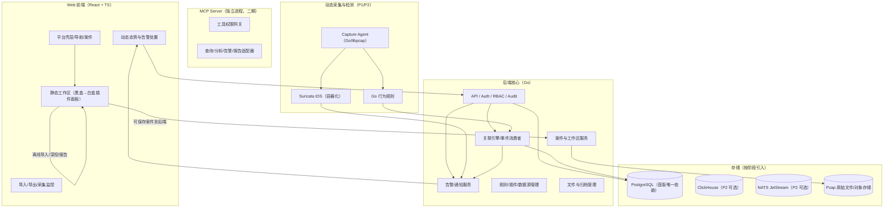
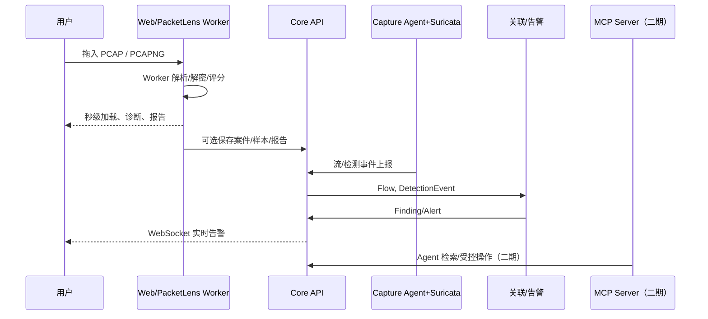

---
AIGC:
    Label: "1"
    ContentProducer: 001191440300708461136T1XGW3
    ProduceID: 91a6ec231204528cf058fec04d8653c4_3db34207a6b611f1b874525400e6dd8f
    ReservedCode1: A4bOMs+gXJ8YyMmRzuOht/wj3ytb+gcn2hdrxX+SHmvMaaNXyx1uEkxnDXbJbmYqNeMrew/07ZSIM01/qjpVAD9b9+3wYtRDwbrFBB6ZWlDtxsLaq2T65kkpqd/Q1gy5iFrwj7azHCwKpUJ8dJDEeFHQZ8hT/8tOplfSXi8lNTcXR5KZHBEgYOvz3M4=
    ContentPropagator: 001191440300708461136T1XGW3
    PropagateID: 91a6ec231204528cf058fec04d8653c4_3db34207a6b611f1b874525400e6dd8f
    ReservedCode2: A4bOMs+gXJ8YyMmRzuOht/wj3ytb+gcn2hdrxX+SHmvMaaNXyx1uEkxnDXbJbmYqNeMrew/07ZSIM01/qjpVAD9b9+3wYtRDwbrFBB6ZWlDtxsLaq2T65kkpqd/Q1gy5iFrwj7azHCwKpUJ8dJDEeFHQZ8hT/8tOplfSXi8lNTcXR5KZHBEgYOvz3M4=
---

# 流量分析平台项目实施方案 2.0

> 版本：V2.0（修订完整版）
> 适用基线：PacketLens（MIT，github.com/ddosi/PacketLens）
> 规模假设：单节点 ≤1Gbps 实时流量、百万级静态数据包、日均万级告警；暂不做多租户
> 交付性质：可直接指导开发、半年内可交付可开源的完整项目方案

## 1. 结论摘要

本项目采用"前端深度静态分析 + 后端动态实时闭环"的混合架构，按**分阶段生长**的方式实施，每阶段可独立运行、独立发布：

- **静态分析侧**复用并增强 PacketLens：浏览器内 Worker 完成 PCAP/PCAPNG 导入、逐字节协议树、HTTPS 解密、离线规则、报告导出，数据不出浏览器；集成路径采用"先黑盒嵌入、后白盒模块化"两阶段演进，把 PacketLens 逐步收敛为 `packetlens-core` 纯模块与可插拔面板。
- **动态分析侧**由 Go 后端补齐：Capture Agent 负责实时抓包与 PCAP 回放、内存环形队列、保存策略；Suricata 以容器化方式提供实时规则匹配；Go 事件关联层完成扫描、信标、隧道等行为分析。
- **统一流量对象与检测事件模型**：静态与动态结果统一进入 `Capture / PacketRef / Flow / Finding / Alert / Artifact` 对象体系，共享案件、研判、导出流程。
- **扩展性以插件化承载**：面板、规则、数据源、导出器按插件接入；核心模块边界从第一周起守死，为后续插件隔离与生态扩展留好接口。
- **实施节奏**：P0 静态闭环（4 周）→ P1 回放采集与插件化（8 周）→ P2 实时检测与告警闭环（6 周）→ P3 硬化、文档与开源发布（8 周含缓冲）。中间件按阶段引入：第一阶段只有 `web + core-api + postgres`，Suricata/ClickHouse/NATS 等在对应阶段再加入。

### 1.1 必须明确的路线取舍

1. **纯前端不能独立闭环**：浏览器无法监听网卡、无法常驻采集、无法在页面关闭后保存告警与处置状态。保留 PacketLens 离线体验，但真实平台必须带后端。
2. **不要从零重写 Wireshark 级解析器**：协议树、TLS 解密、流重组、专家规则是 PacketLens 已实现的差异化资产。先兼容解耦复用，再按模块逐步迁移。
3. **不要按 10Gbps 电信级方案设计**：规模为 ≤1Gbps 单节点，软捕获 + Suricata + Go 后端足够；DPDK/PF_RING/Kafka 集群不作为默认方案，只留扩展口。
4. **服务与中间件必须分阶段引入**：任何阶段都有可运行、可演示、可发布的最小闭环，严禁一次堆齐全部组件再联调。

## 2. 需求矛盾与处理建议

| 需求点 | 风险或矛盾 | 方案建议 |
|---|---|---|
| 纯前端离线 + 动态实时 + MCP + 插件体系 | 两种路线天然冲突 | 静态/离线走浏览器引擎，动态/协作走后端；动态命中会话一键导出 PCAP 进入静态深挖 |
| 1Gbps 全包全量 L7 解析并落盘 | 单机不可能对全部包做无限深度解析与全量保存 | 采集层线速截包，只对会话元数据、关键字段、规则命中窗口做完整 L7 解析；解析深度按速率动态降级并展示"可见性/漏检"指标 |
| 静态"百万级秒开"与后端持久化 | 动态化会破坏 PacketLens 的低延迟内存模型 | 前端保留 `ArrayBuffer + Worker + 虚拟滚动`；后端只持久化分析结果、案件、告警与原始包归档，不从 DB 重建全部包树 |
| 明文凭据/文件还原的合规风险 | 自动化提取放大隐私问题，开源发布更易被滥用 | 仅处理授权数据；敏感功能默认关闭、显式开启并二次确认；UI 强制授权提示；默认遮罩与审计 |
| "未见异常"语义 | 易被误读为安全 | UI 与报告明确"未见异常 ≠ 安全"，只有命中高置信度恶意 IoC 才可标为确认恶意 |
| 插件热更新与安全隔离 | 两者易冲突 | 纯计算插件可 WASM 热替换；网络采集/处置插件必须独立进程由 Supervisor 管理；核心不允许热加载任意代码 |
| 告警处置的真实副作用 | 开源后误封/滥用造成实害与法律风险 | 处置统一走 `DecisionRequest` 审批与审计；首版只内置"模拟 adapter"，真实封禁/阻断 adapter 以插件形式后置 |
| 多租户 | 需求未明确要求 | 不做多租户；单组织 RBAC，用户表预留 `organization_id` |

## 3. PacketLens 研究结论与复用策略

### 3.1 形态判断

PacketLens 是 Vanilla JavaScript 单页工作台，核心集中在单个 `index.html`。它已具备：上百种协议逐字节解析树；TLS 1.2/1.3 解密与 HTTP/2 HPACK 还原；TCP 流重组与凭据/文件/敏感信息提取；离线威胁评分与专家诊断；Web Worker、整数化 IP、虚拟滚动等前端性能方案；完整报告导出。因此将其作为**静态分析引擎与前端工作台参考实现**，集成到交付目录并保留 MIT 声明。

### 3.2 复用与演进两阶段路径（本版关键修订）

为避免"边集成边拆"导致返工，PacketLens 演进强制分两阶段：

**阶段 A：黑盒集成（P0，前 4 周）**
- PacketLens 保持独立构建产物，挂载到 `/static-workspace` 路由；
- 壳层与工作区之间仅用 `postMessage` 定义最小协议，先跑通闭环，不做 UI 合并与源码改动；
- 协议事件：
  - `pl.openCapture(file)`：从平台案件打开 pcap；
  - `pl.analysisComplete(payload)`：Worker 解析完成后把统计摘要回传平台；
  - `pl.saveReport(blob)`：报告导出到案件；
  - `pl.requestPcap(attachmentId)`：从后端取回案件附件继续分析。

**阶段 B：白盒模块化（P1 起）**
- 在阶段 A 闭环稳定的前提下，按第 6 章契约把解析/过滤/提取逻辑拆入 `packetlens-core` 纯模块，UI 面板逐步插件化；
- 模块边界：`packetlens-core` 内禁止 React/DOM 依赖；所有模块经 `schema.json` 契约通信；UI 只消费契约；
- 任何迁移保持过滤器与报告契约不变，每拆一个模块跑一次回归样本集。

### 3.3 复用原则

1. `packetlens-core` 隔离原代码，不在主业务代码中散落修改；
2. 通过稳定 JSON 契约对外输出：统计、协议树引用、会话、DNS/HTTP/TLS、凭据、文件、IoC、诊断、处置记录；
3. 壳层提供登录、导入管理、案件、插件管理、动态模式导航；
4. 后续可选把 JS 解析器按协议迁移 TypeScript/Rust，但不作为首版目标。

## 4. 总体架构

### 4.1 目标进程拓扑（分阶段引入）

```text
P0（第 1~4 周）：
  web-static + core-api + postgres

P1（第 5~12 周）：
  P0 + capture-agent（回放优先）

P2（第 13~18 周）：
  P1 + suricata（容器化）+ clickhouse（可选）+ nats（可选）

P3（第 19~26 周）：
  硬化、监控评估、文档、开源发布
```

> 说明：ClickHouse/NATS/Redis/Prometheus/Grafana/Loki 均非首版必需。PG 先承担业务与事件存储；当告警明细与流事件达到千万级且查询变慢时，再引入 ClickHouse，接口层从第一天就做好存储抽象。NATS 只在多采集器或事件吞吐成为瓶颈时引入。监控先以结构化日志 + `/healthz` 覆盖，服务数稳定后再评估全家桶。

### 4.2 分层视图



### 4.3 静态/动态两条分析链路



### 4.4 模块划分

| 模块 | 职责 | 关键边界 |
|---|---|---|
| `web-static` | 静态工作台：导入、17 面板、离线报告；P1 起面板插件化 | 数据默认在浏览器内存；仅用户选择后保存 |
| `web-dynamic` | 实时仪表盘、告警队列、采集健康 | 只通过 API/WebSocket 消费后端事件 |
| `core-api` | REST/WebSocket、认证、案件、告警、规则、采集管理 | 所有写操作经审计中间件 |
| `packetlens-core` | 解析/过滤/会话/提取/评分/报告的纯模块集合 | 无 DOM/框架依赖，只走契约 |
| `capture-agent` | libpcap/回放、环形队列、保存策略、导出 pcap | 采集性能敏感，不做昂贵解析 |
| `detect-signature` | Suricata EVE JSON 转 DetectionEvent（P2） | 规则匹配性能敏感 |
| `detect-behavior` | 扫描/信标/DNS 隧道/攻击链聚合（P2） | 读流摘要指标，不重读包 |
| `plugin-host` | 插件注册、生命周期、状态机（P1 起） | 首版为前端面板插件；进程级插件后置 |
| `mcp-server` | MCP 工具网关（二期） | 独立进程；读写工具二次授权 |
| `storage` | PG/文件归档统一访问 | 业务层不直接拼 SQL |

## 5. 数据流与核心数据结构

### 5.1 主数据流

1. **静态导入**：文件进浏览器 Worker → 字节解析 → 包索引与协议树 → 流/应用层摘要 → 规则与评分 → 面板与报告；
2. **动态采集（P1 起）**：网卡/回放 → Capture Agent 环形队列 → 原始包按策略写盘 → Suricata/行为规则检测 → DetectionEvent 入库 → 关联生成 Alert → WebSocket 推送；
3. **动态转静态**：告警/会话被选择后导出 PCAP，作为案件附件交给静态模式重跑全量管线。

### 5.2 核心数据对象

| 对象 | 主要内容 |
|---|---|
| `Capture` | 名称、类型、源、文件哈希、时间范围、保存策略 |
| `PacketRef` | capture_id、frame_no、时间、方向、长度、摘要、数据块引用 |
| `ProtocolTree` | 节点字段名/值/字节偏移/十六进制区间，双向高亮 |
| `Flow` | 5 元组、字节/包、时序、RTT/重传/零窗口、应用协议 |
| `Session` | 同源去重后的请求/响应、DNS 事务、TLS 会话、TCP 流引用 |
| `Finding` | 规则、证据、严重级别、处置状态、MITRE |
| `Alert` | 实时告警：去重 key、抑制窗口、验证状态、证据窗口 |
| `AttackEvent` | 多告警聚合攻击阶段（P2） |
| `Credential` | 来源（明文/解密）、协议、用户名、口令、证据 |
| `Artifact` | 提取文件、SHA-256、来源流、下载引用 |
| `Ioc` | 类型、值、来源、白名单、评分、证据、ATT&CK |
| `Case` | 案件、关联 Finding/包/文件、处置记录、时间线 |
| `AuditEvent` | 用户、动作、资源、结果、前后状态 |

### 5.3 事件主题约定

```text
traffic.raw       原始包/包块引用
traffic.flow      流统计与健康
traffic.app       HTTP/DNS/TLS 应用事件
detect.sig        Suricata/YARA 命中
detect.behavior   行为规则命中
alert.lifecycle   告警生成/合并/抑制/处置
case.lifecycle    案件变化
plugin.event      插件注册与运行事件
capture.health    队列水位、丢包、延迟
```

事件统一携带 `trace_id`、`capture_id`、`source_kind`（static|live）、`privacy_mode`，保证从告警到证据可回溯。

## 6. 技术栈选型与分阶段引入

### 6.1 抓包与解析层

| 方案 | 定位 |
|---|---|
| Go `gopacket` + libpcap | 动态采集主路径；Linux AF_PACKET、Windows npcap（开发以 WSL2 + Docker 为主） |
| PacketLens 浏览器解析器 | 静态深挖主路径，封装为 `packetlens-core` |
| Suricata | 动态实时签名检测（P2 容器化引入） |
| tshark | 仅测试/验证辅助，不作为实时主解析器 |
| Scapy/Python | 仅测试样本构造 |

### 6.2 数据存储（按阶段）

| 存储 | 引入阶段 | 用途 |
|---|---|---|
| PostgreSQL 16 | P0 必选 | 用户、角色、规则、案件、插件、审计、告警、流摘要（首版唯一数据库） |
| ClickHouse | P2 可选 | 流/事件/告警明细高速查询；存储接口先抽象，量级上来再迁移 |
| NATS JetStream | P2 可选 | 事件总线；单机 nats-server 即可，多采集器时不换架构 |
| 文件/对象存储 | P0 | 原始 PCAP、提取文件、报告、加密密钥材料 |
| Redis | 暂不引入 | WebSocket 会话可用内存 + PG 兜底，确有必要再加 |

存储策略：
- 原始包按"块文件 + 索引"保存：每 N 万包或 N 分钟切块，记录 SHA-256 与时间/接口元数据；
- 百万级静态导入不强制入库，仅"保存分析结果/加入案件"时才写库；
- 删除策略软删除 + 延期物理删除，删除二次确认并审计。

### 6.3 后端

- Go 1.22+：Core API、Capture Agent、行为关联、插件 Supervisor 主语言；
- 标准 `net/http` 或 `chi`，不引重量级框架；
- goroutine worker pool + 有界 channel；跨进程事件经存储抽象（先 PG，后 NATS）。

### 6.4 前端与可视化

- React 18 + TypeScript + Vite：平台壳层、动态仪表盘、管理页；
- PacketLens 静态工作区：阶段 A 独立挂载，阶段 B 拆为插件面板；
- Ant Design 5（管理端）、ECharts（时序图）、Cytoscape.js（拓扑/攻击链，P1/P2 按需）、TanStack Virtual（长列表）、TanStack Query + Zustand；
- 浏览器解析状态不进入 React Store。

### 6.5 规则引擎

| 引擎 | 定位 |
|---|---|
| Suricata | 实时签名检测（P2） |
| 自研行为规则 | 扫描、信标、DNS 隧道、攻击链聚合（P2 起步 3~5 条规则） |
| PacketLens 专家规则 | 静态模式直接复用 |
| YARA | 文件还原检测（可选插件） |
| Sigma | 仅预留事件源插件，不作为主检测器 |

统一规则模型：所有规则产出 `DetectionEvent`（rule_id、rule_source、severity、evidence、mitre、suppression_key）。规则管理页可启停、改阈值、设白名单。

### 6.6 MCP Server（二期）

- 协议：MCP 2026-07-28，兼容 2025 系列版本；本地 stdio、远程 SSE/HTTP；
- TypeScript SDK 独立进程；所有工具调用写 `mcp_call_audit`；
- 写工具角色检查 + 审批事件；只读工具限流；原始包访问走 Core API 临时授权引用。

### 6.7 插件运行时（分阶段）

- P1：前端面板插件（manifest + iframe/消息通道 + 事件总线），跑通注册/启停/依赖检查；
- P2+：规则/检测器插件与 WASM 隔离评估；
- 后置：进程级 gRPC 插件、容器隔离、签名校验、配额熔断——作为二期增量，不阻塞核心闭环。

### 6.8 认证与权限

- P0：本地单管理员 + Argon2id + JWT Access/Refresh；用户/角色表结构按 RBAC 设计但管理页后置；
- 企业部署预留 OIDC 对接位；
- RBAC 角色：viewer / analyst / operator / admin（按需逐步启用）。

### 6.9 实时推送

- 动态告警/处置/采集健康：WebSocket，按 `capture_id + role` 订阅；
- 大报告/导入进度：SSE；
- 断线重连按游标补增量。

### 6.10 可观测性

- P0~P2：结构化 JSON 日志、`/healthz`、核心指标（抓包丢弃、队列水位、告警时延）暴露 Prometheus 格式端点；
- 服务数稳定后：Grafana/Loki/Tempo 按需引入，不作为首版依赖。

## 7. 静态分析模式详细设计

### 7.1 导入与包存储

- 支持 `pcap/pcapng/cap/dmp/snoop`，拖放、选择、剪贴板；
- 大文件分段解析：先建包偏移索引，再按需 Worker 解析当前视图；超 200MB 提供 editcap 建议与后端导入通道；
- 多文件合并：同源去重 + 时间轴排序；
- 导入后生成不可变 `Capture` 摘要，切换文件主动释放大 ArrayBuffer。

### 7.2 协议树、列表与联动

- Worker 输出轻量列表记录 + 惰性协议树数据；主线程用 `ArrayBuffer.subarray` 按需重建；
- 字段树保存字节偏移与长度，悬停/选中联动十六进制；点击十六进制反向定位；
- 列表固定列：No、时间、源、源端口、目的、目的端口、协议、长度、INFO；虚拟滚动；
- 过滤结果支持 Ctrl+S 导出 CSV 或另存 PCAP。

### 7.3 过滤器设计

兼容 Wireshark 显示过滤器语法（不引入其二进制）：Tokenizer → AST → 类型化求值器，无 eval；字段注册表覆盖 frame/eth/vlan/arp/ip/ipv6/tcp/udp/icmp/dns/http/tls/dhcp 及 `pkt.bad` 扩展字段；IPv4 解析期整数化；图形化构造器与保存模板。

### 7.4 会话、流与图表

- 会话按"五元组 + 协议 + 时间"，双向流用规范化流键；
- TCP 流重组滑动窗口，单流上限 6MiB 可配置，超限标记 `truncated`；
- 流状态与健康：ESTABLISHED/HALF_CLOSE/CLOSED/RESET/UNKNOWN、RTT、重传、零窗口、重复 ACK、缺口；
- 图表：吞吐、包长分布、TCP 事件/秒、TOP 端口、TCP 标志位；
- 拓扑（P1/P2 按需）：节点大小按流量、边按字节，节点分类内网/公网/可疑，双击过滤，支持 40/80/150/300 节点上限。

### 7.5 应用层专项

- DNS：查询-响应配对、去重域名、NXDOMAIN、慢事务、明文解析器、时延；
- HTTP：事务、URI/状态/类型/大小/耗时、TOP 主机、UA 统计、解压预览；
- TLS/证书：SNI/版本/套件/ALPN/JA3/JA4、证书 CN/颁发者/有效期/自签/弱签名、KeyUpdate；
- 主机清单：IP 分类、MAC 厂商、OS 指纹、ARP 冲突、DHCP 主机名。

### 7.6 HTTPS 解密

- 密钥来源：拖放 keys.log、对话框、pcapng DSB 内嵌密钥块；
- 密钥只驻留浏览器内存；刷新/切换/导出前不写盘；后端仅保存用户主动上传的加密密钥附件；
- 支持 TLS 1.2/1.3 AES-GCM、ChaCha20-Poly1305、KeyUpdate；CBC 老套件与 AES-CCM 标记不支持；
- 解密后自动重跑 HTTP/2 HPACK、HTTP/1.1、事务、凭据、文件、威胁指标；
- 凭据与文件来源打标 `link-plaintext` / `decrypted`；
- MITM/eBPF 不作为默认能力。

### 7.7 取证与敏感信息

- 凭据提取：HTTP Basic、POST form/JSON、Telnet、FTP、SNMPv2c、Cookie/令牌；
- 文件还原按魔数识别 HTML/PNG/DER/EXE 等，计算 SHA-256，支持送插件分析；
- 敏感信息用可配置正则（手机号、身份证、JWT、云厂商 AccessKey），默认提示级展示；
- **开源边界**：凭据/文件/敏感信息提取默认关闭，用户在授权数据集上显式开启；导出必须进入案件；UI 强制授权提示。

### 7.8 已知边界处理

| 边界 | 处理 |
|---|---|
| QUIC/HTTP3 | 标记未解密，识别初始包与握手元数据，预留解析插件 |
| IP 分片 | 静态默认"标记不合并"，提供合并视图开关 |
| TCP 单流 6MiB | 上限可配置；截断在报告标记 |
| 启发式误报 | 每条 Finding 给"为什么报、替代解释、置信度"，进入人工确认 |
| "未见异常" | 报告明示 ≠ 安全 |
| 校验和错误 | 仅标记不阻断 |
| 大文件 | editcap 提示、后端分块导入、过滤后导出 |

### 7.9 报告导出

格式：Markdown、HTML、JSON、CSV、PCAP、IoC TXT/CSV、IP/域名 CSV；可配置 TOP 条数、证据条数、语言、章节；快照保存版本号与数据源哈希。

## 8. 动态分析模式详细设计

### 8.1 采集接入（P1 起）

数据源统一为 `DataSource` 插件：本机网卡实时抓包、端口镜像接入、NFLOG/NFQUEUE、**离线 PCAP 回放（优先实现，用于规则回归与开发验证）**。采集器配置含：接口、过滤表达式、保存策略、磁盘配额、脱敏策略、授权负责人；启动时 UI 展示隐私与授权提示。开发与演示环境统一 WSL2 + Docker；Windows 本机不依赖 npcap 主路径。

### 8.2 内存环形队列

双队列：`raw_ring`（原始包字节 + 元数据）与 `event_ring`（轻量事件引用）。满时淘汰最旧包并更新 `dropped_oldest_total`；"仅威胁保存"策略命中时冻结证据窗口（前后 M 包/T 秒）异步归档；水位分级 正常/偏高/临界/溢出，临界以上推送 `capture.health`。

### 8.3 保存策略

| 策略 | 行为 | 适用场景 |
|---|---|---|
| 全量保存 | 全部或关键会话按块写盘，普通流量压缩归档 | 事后回溯、取证 |
| 仅威胁保存 | 只保存命中窗口与上下文，普通流量留统计 | 兼顾检测与隐私 |
| 不保存 | 纯内存实时分析 | 隐私/合规敏感 |

运行中切换二次确认并生成审计事件；磁盘配额 + 滚动清理 + 可选加密；已归档数据不可变。

### 8.4 实时检测（P2 起）

- 签名检测：Suricata（容器化）EVE JSON 转 `DetectionEvent`；
- 行为检测：Go 统计引擎基于流摘要，起步覆盖端口扫描、周期信标/C2、DNS 隧道、横向移动候选、ARP 变化、低频信号（独苗 JA3/单点域名）；
- 文件检测：YARA 插件（可选）；
- 端到端告警目标 P95 <1s。

### 8.5 告警、去重与通知

- 字段：alert_id/rule_id/severity/source_ips/dst_ips/suppression_key/first_seen/last_seen/count/evidence_window/status；
- 去重窗口 60s；抑制：白名单资产、规则抑制、告警抑制窗口、维护窗口；
- 通知：Web 实时、Webhook、SMTP（可配置最低级别）；
- 未确认高危进"待决队列"。

### 8.6 处置决策与授权边界（首版安全边界）

处置统一使用 `DecisionRequest`，**首版只实现记录 + 模拟执行 adapter**，不直接调用防火墙/iptables 等真实动作；真实封禁/阻断/会话终止 adapter 以插件形式作为二期增量（默认关闭、审批、可回滚、全审计）。所有执行动作记录：谁、何时、目标、动作、规则、结果、回滚引用。

### 8.7 实时可视化与采集健康

仪表盘：当前吞吐、pps、队列水位、丢弃率、处理延迟、告警趋势、TOP 攻击源/目标、协议构成、活跃会话。丢包率 >0.1% 或溢出时页面变红告警；多步关联生成 `AttackEvent` 与攻击链图（P2）。

### 8.8 动态转静态闭环

选择告警/会话/时间窗 → 后端导出 PCAP（保留时间与接口上下文）→ 生成 CaseAttachment → Web 打开静态工作区深挖 → Finding 回写同一 Case。

## 9. 威胁情报、规则与研判统一设计

### 9.1 离线威胁评分

指标对象：IP、域名、URL、哈希、证书、JA3/JA4；评分输入：IoC 命中、内置风险特征、证书异常、DNS 结构、文件信号、行为组合；输出 score/confidence/grade：确认恶意/高度可疑/可疑/需关注/未见异常/白名单/内网非路由；证据链含命中信号、证据包、MITRE。

### 9.2 IoC 与白名单

支持 IP/域名/URL/哈希/JA3/JA4/证书指纹导入；白名单来源：内网资产、DHCP/ARP 学习、用户导入；记录创建人、理由、有效期，过期自动降级；在线情报只提供"手动打开/复制 curl"入口，默认不外呼。

### 9.3 规则生命周期

内置规则不可直接覆盖，复制后可编辑；版本化 + 审计 + 回归测试；规则绑定数据源类型、资产范围、告警级别、抑制条件。

### 9.4 案件与工作区

案件含时间线、Finding、PacketRef、Artifact、IoC 记录、规则抑制、导出证据；分析状态持久化（过滤器/视图/标注/处置）；协审用"版本快照 + 评论 + 审计"，不做实时协同。

### 9.5 IP 归属与在线情报扩展位

内置 GeoLite2 Country/ASN（gz/mmdb，启动载入）；`intel-provider` 插件接口预留 VirusTotal/微步等，默认关闭；平台不自动同步内部信息给第三方，在线查询需显式勾选单条指标。

## 10. 插件体系详细设计

### 10.1 插件类型与注册（分阶段）

| 类型 | 提供能力 | 引入阶段 |
|---|---|---|
| `ui-panel` | 面板级功能（DNS/HTTP/TLS/报告等） | P1 |
| `rule-set` | 新增规则/检测器 | P2 |
| `exporter` | 新增导出格式 | P1/P2 |
| `datasource` | 新增采集输入 | P1 |
| `analyzer` | 文件/恶意样本分析 | 后置 |
| `action` | 真实处置 adapter | 二期（默认关闭） |
| `dissector` | 新增协议 | 后置 |

插件包结构：

```text
plugin/
  manifest.yaml
  index.js            # 前端插件注册入口
  schema.json         # 面板输入/输出契约
  README.md
```

`manifest.yaml` 声明：apiVersion、id、version、kind、entry、requires（core 版本/事件 schema）、capabilities。

### 10.2 注册中心与生命周期（P1 交付范围）

- 注册/注销、按 manifest 挂载面板、状态机 registered/enabled/disabled/error、依赖检查、事件总线；
- 插件启停经 UI 管理页操作，核心代码不热更新；
- 首版插件为前端面板（iframe + 消息通道），进程级隔离、WASM 沙箱、签名校验、配额熔断后置。

### 10.3 插件化重构顺序建议

先拆最简单面板跑通链路：包列表/协议树 → 过滤器 → 会话流 → 图表 → DNS/HTTP → 报告。每个面板迁移后跑固定样本回归，确保行为不变。

## 11. MCP 集成（二期）

- 独立服务随 Compose 管理，不内嵌 Core API；本地 stdio、远程 SSE/HTTP + API Key/mTLS；
- 工具分只读与写两类：`capture.* / packet.search / session.list / http.list / dns.list / tls.list / credential.list / finding.* / ioc.search / report.generate / alert.list` 等；写工具（decision.create 等）审批 + 限流 + 审计；
- 工具幂等：`request_id` 去重；错误码统一：resource_not_found/permission_denied/unsupported_filter/analysis_running/quota_exceeded/requires_approval；
- 大数据结果分页或导出任务，避免 JSON-RPC 响应过大。

## 12. API 设计与部署形态

### 12.1 REST 资源

```text
/api/v1/auth /users /roles
/api/v1/captures /captures/{id}/packets|sessions|flows|dns|http|tls|findings
/api/v1/artifacts /iocs /rules /plugins /datasources
/api/v1/alerts /alerts/{id}/decisions /cases /audit /reports /settings
```

查询统一 page/limit/sort/fields；错误 RFC 7807；写操作返回 `request_id` 幂等；原始包不走 REST 主通道，用短期签名 URL；契约以 OpenAPI 3.1 为准并在 CI 校验。

### 12.2 数据库设计

PostgreSQL 核心表（首版）：

```text
users, roles, user_roles, audit_events
captures, capture_blocks, datasources, packet_imports
cases, case_attachments
findings, alerts, alert_decisions
rules, rule_versions, plugin_manifests
workspaces, annotations, case_events
iocs, allowlists, report_jobs
```

动态事件表（P1 起，先落 PG）：`flow_events / detection_events / alert_events / capture_metrics`；表结构按时间分区预留，量级上来再迁移 ClickHouse。

### 12.3 部署形态（分阶段 Compose）

```text
P0:  web, core-api, postgres
P1:  追加 capture-agent
P2:  追加 suricata（可选 clickhouse、nats）
P3:  评估 prometheus/grafana（可选）
```

多传感器扩展路径：每现场部署 `capture-agent（+suricata）`，经 HTTPS/NATS 上报中心，不上报未授权原始载荷。

## 13. 性能目标、优化与验证

| 指标 | 目标 | 验证方式 |
|---|---|---|
| 实时采集 | 单节点稳定 ≤1Gbps，不因解析反压丢包（策略淘汰除外） | 回放压测观察 dropped/queue |
| 静态导入 | 100MB pcap 首屏可交互 <3s | 固定机配置 + Performance API |
| 包列表 | 百万包虚拟滚动 >50fps | Playwright + DevTools |
| 规则匹配 | Suricata ≥500Mbps（8 核参考）；行为规则不阻塞抓包 | EVE 产出延迟统计 |
| 告警端到端 | 命中到可见 P95 <1s | 注入标记包 |
| 静态过滤 | 百万包 P95 <500ms | 基准样本 |
| 报告 | 百万包 MD/JSON <10s；HTML <15s | 自动化压测 |

前端性能策略：Worker 承担解析/重组/统计，主线程只渲染轻量列表；深层载荷按偏移重建；IPv4 整数化 + 字段索引；虚拟滚动 + 固定行高；图数据先降采样；大数组即用即弃显式释放。

## 14. 安全、隐私与合规（含开源发布边界）

### 14.1 抓包授权

采集器必须配置授权来源、责任人、用途、到期时间；启动前强制展示授权与隐私确认；演示模式仅限回环/测试样本。

### 14.2 隐私脱敏

默认展示完整证据给授权分析师，按角色可开启脱敏视图；推荐"展示/导出时脱敏 + 审计"，不主动在采集层破坏原始证据；脱敏字段：IP（保留网段/哈希）、用户名口令、Cookie、URL query、文件内容。

### 14.3 数据安全

原始包文件加密存储可选（LUKS/对象存储 KMS）；密钥只在浏览器内存；日志不记录明文口令/解密内容/完整载荷；删除软删除 + 延期物理删除 + 二次确认 + 审计。

### 14.4 平台自身安全

前端禁用 eval、过滤器 AST 化、插件 UI iframe 隔离；API 鉴权、限流、CSRF 防护；所有查询按当前用户可见 capture_id/case_id 强制过滤；插件不授予直接数据库/文件系统权限。

### 14.5 开源发布安全清单

- 主项目 License 选 MIT（与 PacketLens 一致），引入其他组件时校验兼容性，必要时目录级隔离；
- 保留 PacketLens 版权声明（代码内 + NOTICE）；
- README 免责声明：仅限用户拥有或获授权的流量；遵守当地法律；禁止未授权监控；
- 凭据提取/文件还原等敏感功能默认关闭、显式开启；
- 不内置真实封禁/阻断实现，仅模拟 adapter；
- SECURITY.md、CONTRIBUTING、issue/PR 模板；
- 发布前扫描无硬编码凭据、内部地址、个人信息残留。

## 15. 测试与验证方案

### 15.1 固定样本集（W2 前建立）

- 良性：Wireshark sample captures、自抓 HTTPS/HTTP/DNS 日常流量；
- 恶意：Malware-Traffic-Analysis、Stratosphere IPS、PacketTotal 公开样本（隔离 VM/沙箱处理，禁止开发机直开）；
- 构造：DNS 隧道、C2 信标、端口扫描、TLS 弱套件、明文凭据、ARP 欺骗、文件传输（脚本化自建 pcap）。

### 15.2 指标口径

检测率（标注样本正确命中比例）、误报率（人工复核误报占比）、性能（固定 8C16G NVMe 基准）、对抗验证（良性混合流量中统计漏报误报，避免只跑"容易命中"样本）。

### 15.3 自动化测试矩阵

| 层级 | 内容 |
|---|---|
| 单元 | 解析、过滤 AST、规则阈值、TLS 密钥解析、pcap 分块 |
| 回归 | 固定样本命中快照对比（每次迭代必跑） |
| API | 权限矩阵、幂等、分页、错误码 |
| E2E | Playwright：导入 pcap → 过滤 → 会话 → 告警 → 报告 |
| 平台安全 | XSS/CSRF/SQLi/IDOR/越权 |
| 插件 | 恶意插件越权、死循环、内存超限（P1 起逐步） |

## 16. 实施排期（26 周，双周迭代）

> 节奏：每双周产出可运行版本并更新 CHANGELOG。**迭代延期超过 1 周时，砍该迭代的后置功能，不拖总工期。**

| 周次 | 阶段 | 目标 | 验收标准 |
|---|---|---|---|
| W1~2 | P0 | 工程骨架 + PacketLens 黑盒集成 | 一键启动；静态工作区挂载且 postMessage 协议可调用 |
| W3~4 | P0 | 静态 MVP 闭环 | 100MB pcap 导入、案件保存/恢复、报告导出 MD/HTML |
| W5~6 | P1 | core 白盒化启动 | 解析/过滤拆出纯模块，单测覆盖 |
| W7~8 | P1 | 插件注册中心 | 2 个面板插件化，可独立启停 |
| W9~10 | P1 | capture-agent 回放 | Docker 内回放 pcap 出流事件入库 |
| W11~12 | P1 | 动态转静态闭环 | 回放样本可查流/会话，导出 pcap 回静态深挖 |
| W13~14 | P2 | Suricata + 行为规则 | 扫描/信标/DNS 隧道样本端到端 <1s 告警 |
| W15~16 | P2 | 告警推送 + 采集健康 | Web 实时告警、队列水位可视化 |
| W17~18 | P3 | 前端性能硬化 | 百万包滚动 >50fps、过滤 P95 <500ms |
| W19~20 | P3 | 安全与测试补强 | 单元/E2E/对抗样本通过、安全自查完成 |
| W21~22 | P3 | 文档 + 演示环境 | 架构/用户/部署文档齐全、演示脚本可用 |
| W23~24 | P3 | 开源发布准备 | License、免责、CI 公开、README 完成 |
| W25~26 | 缓冲 | 收尾 | 修复遗留 issue、CHANGELOG v1.0 |

## 17. 与 PacketLens 能力对标表

| 能力 | PacketLens 现状 | 本项目实现方式 | 本项目增强/取舍 |
|---|---|---|---|
| 数据包解析与浏览 | 已实现 | 黑盒集成→core 模块化 | 后端大文件分段导入、多文件合并、归档去重 |
| 逐字节协议树/十六进制联动 | 已实现 | 保持并模块化 | 字段注册表/插件扩展点 |
| Wireshark 语法过滤 | 已实现 | 复用 | AST 化 + 图形构造器 + 模板 |
| 会话/端点/流 | 已实现 | 复用 | 动态流与静态流统一 Flow 模型 |
| TCP 流跟踪与健康 | 已实现 | 复用 | 可配置上限、证据窗口导出 |
| 图表 | 已实现 | 复用 | 实时仪表盘复用组件 |
| 通信拓扑 | 已实现 | P1/P2 按需 | 与告警/资产联动 |
| DNS/HTTP/TLS 专项 | 已实现 | 复用 | 与动态事件统一 |
| 明文凭据/文件还原 | 已实现 | 复用（默认关闭） | 来源标记 + 导出授权 + 案件 |
| 离线威胁评分/IoC | 已实现 | 复用 | 白名单生命周期、动态告警引用 |
| 专家诊断规则 | 已实现 40+ | 复用并版本化 | 与 Suricata/YARA 统一 DetectionEvent |
| 态势研判作战台 | 静态版 | 保留静态版 | 动态告警、处置、攻击链（P2） |
| 报告导出 | MD/HTML/JSON/CSV | 复用 | 报告任务、版本快照 |
| HTTPS 解密 | 已实现 | 复用 | 密钥仅内存；边界明确 |
| 纯前端零后端 | 是 | 保留为静态子能力 | 整体带后端：动态/协作由后端承担 |

## 18. 阶段范围定义

### P0（第 1~4 周）范围

Docker Compose：web + core-api + postgres；单管理员登录；PacketLens 黑盒集成；pcap/pcapng 导入、包列表/协议树/过滤器/会话/图表/DNS/HTTP/TLS/凭据/文件/IoC/诊断/报告导出；案件保存/恢复。

### P1（第 5~12 周）范围

core 白盒化与插件注册中心；capture-agent（回放优先）与环形队列、保存策略；流事件入库；动态转静态 PCAP 闭环；2 个以上面板插件化。

### P2（第 13~18 周）范围

Suricata 容器化接入与行为规则起步；告警去重/抑制/WebSocket 推送；采集健康监控；ClickHouse/NATS 按实际量级评估引入；攻击链聚合可选。

### P3（第 19~26 周）范围

前端性能达标；安全测试补强；完整文档；开源发布清单逐项完成；缓冲收尾。

### 明确后置（二期/增量，不阻塞发布）

MCP Server、真实处置 adapter、进程级插件隔离与签名、WASM 沙箱、在线威胁情报自动调用、多采集器中心集群、多租户、OIDC 强制接入、DPDK/PF_RING。

## 19. 文档清单

| 文档 | 阶段 | 用途 |
|---|---|---|
| `docs/architecture.md` | P0 | 总体架构、模块边界、部署拓扑 |
| `docs/data-model.md` | P0 | 核心对象、数据库表 |
| `docs/api/openapi.yaml` | P0~P2 | 前后端契约 |
| `docs/filter-syntax.md` | P0 | 过滤器 AST、字段注册、图形查询 |
| `docs/decryption.md` | P0 | TLS 密钥来源、解密限制、取证说明 |
| `docs/packetlens-integration.md` | P0 | 黑盒 postMessage 协议、白盒模块化契约 |
| `docs/plugin-sdk.md` | P1 | 插件 manifest、面板接口、安全要求 |
| `docs/rules.md` | P2 | Suricata/行为规则编写与回归 |
| `docs/deployment.md` | P3 | Compose、升级、备份、传感器扩展 |
| `docs/operations.md` | P3 | 监控指标、告警处理、故障排查 |
| `docs/user-manual.md` | P3 | 静态/动态用户手册 |
| `docs/security.md` | P3 | 平台安全、脱敏、合规、开源边界 |
| `docs/adr/*.md` | 全程 | 架构决策记录（每个模块记"为什么这样设计"） |
| `docs/test-plan.md` | 全程 | 样本集、指标、自动化测试 |

## 20. 落地风险清单

| 风险 | 影响 | 应对 |
|---|---|---|
| PacketLens 单体改造慢 | 插件化延期 | 两阶段路径：黑盒先跑通，白盒按模块拆，不阻塞主线 |
| 中间件全家桶拖工期 | 整体延期 | 分阶段引入；任何阶段可独立发布 |
| Suricata/动态采集在 Windows 难验证 | 卖点无法演示 | WSL2 + Docker 统一环境；回放模式优先 |
| 样本处理事故 | 安全事件 | 恶意样本隔离 VM/沙箱 |
| 单人延期 | 交付打折 | 双周可验收迭代 + W25~26 缓冲 + 砍功能不砍工期 |
| 开源滥用/法律风险 | 项目与法律风险 | 免责声明 + 敏感功能默认关 + 无真实处置实现 |
| 处置误操作 | 实害 | 首版模拟 adapter + 审批审计；真实 adapter 二期默认关闭 |
| 性能不达标 | 体验差 | W17~18 专项窗口 + 固定基准机 |

## 21. 最终实施建议

施工顺序：P0 先让"静态分析 + 案件闭环"真实可用；P1 打通"回放采集 + core 白盒化 + 插件注册中心"；P2 上 Suricata 实时检测与告警闭环；P3 硬化、文档、开源发布。守住三条底线：**分阶段引入中间件、PacketLens 黑盒→白盒两阶段路径、固定样本集每迭代回归**。高级组件（MCP、真实处置、进程级插件隔离、CH/NATS 全家桶）一律后置为二期增量——宁可功能少而真，不要服务多而假。保持模块边界与 ADR 文档从第一周起真实沉淀，项目在半年内可交付、可开源，并为后续模块级增量开发留下清晰接口。
*（内容由AI生成，仅供参考）*
